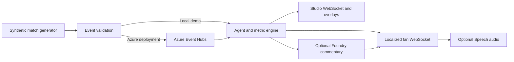

# PitchPulse AI

PitchPulse AI turns synthetic football match events into live tactical context for broadcast analysts and a personalized feed for fans. The studio shows pitch position, an event timeline, pass difficulty, nearby defensive pressure, passing accuracy, and analyst cues. The fan feed offers factual updates in English, Spanish, French, German, and Arabic, with a choice of commentary style and optional speech.

The local demo runs without an Azure account. This repository also includes a manual Azure deployment workflow for people who want to host their own copy. It does not include a licensed live match feed, and a live Azure deployment has not been verified for this repository.

[Studio screenshot](media/studio-demo.png) · [Fan feed screenshot](media/fan-demo.png) · [Two-minute project video](media/pitchpulse-pitch.mp4)

## Run locally

Python 3.11 is tested in CI. From the repository root, install the gateway dependencies and start the synthetic match stream:

```powershell
python -m venv .venv
.venv\Scripts\python -m pip install -r requirements-gateway.txt
.venv\Scripts\python -m scripts.demo_local
```

On macOS or Linux, replace `.venv\Scripts\python` with `.venv/bin/python`.

| Page | What it does |
| --- | --- |
| [Broadcast studio](http://127.0.0.1:8000/studio?match_id=demo-match) | Displays the live match map, tactical metrics, event feed, and analyst overlay. |
| [Fan feed](http://127.0.0.1:8000/fan?match_id=demo-match) | Lets a fan choose a match, language, commentary style, and voice preference. |
| [Self-host setup](http://127.0.0.1:8000/setup) | Guides a fork owner through their own GitHub and Azure configuration. |

These links work while the local server is running. Stop it with Ctrl+C. The fan feed saves its match and viewing preferences in that browser. Factual localized updates work without a Foundry model or Speech resource.

## Deploy your own fork

Fork this repository and use the local [self-host setup screen](http://127.0.0.1:8000/setup). Enter your fork's GitHub owner and repository name plus your Azure subscription, tenant, app, and resource identifiers. The screen saves those identifiers in browser `localStorage` for the current site and restores them when you return. It generates links to **your fork's** Actions secrets, variables, and deployment workflow.

The setup screen does not send entered values to a server or configure GitHub or Azure on your behalf. Do not enter passwords, client secrets, API keys, or connection strings. Use **Clear saved details** to remove the browser copy. The [Azure setup guide](docs/AZURE_SETUP.md) covers the resource group, Entra app registration, OIDC federated credential, required GitHub settings, and role assignments.

After adding those settings in your fork, run **Deploy Azure services** manually from its Actions tab. The workflow builds the gateway image, deploys the broadcast and fan Container Apps, and runs a staging check through Event Hubs and both deployed WebSockets. Azure resources can incur charges. Pushing code alone does not start this deployment.

Foundry commentary is optional. It requires both `FOUNDRY_PROJECT_ENDPOINT` and `FOUNDRY_MODEL` repository variables and model access for the gateway identity. Without them, the studio analysis and multilingual factual fan updates still work. Speech uses the Azure Speech resource provisioned by the infrastructure deployment.

## How it works



The [architecture notes](docs/ARCHITECTURE.md) describe the event contract, calculations, Azure resources, and data flow. The [pitch overview](docs/PITCH.md) explains the audience and product. The [gateway operations guide](src/gateway/OPERATIONS.md) lists runtime configuration.

## Verify the project

```powershell
.venv\Scripts\python -m pip install -r requirements-dev.txt
.venv\Scripts\python -m unittest discover -s tests -v
.venv\Scripts\python -m scripts.benchmark_stream --events 200 --studio-clients 10 --fan-clients 50
```

The local benchmark covers in-process validation, analysis, and WebSocket sends. It does not measure Azure Event Hubs, network travel, Foundry, or speech. [Pipeline tests](.github/workflows/ingestion-ci.yml) also build both container images and test the Event Hubs SDK against an emulator. A deployed latency claim requires the [Azure staging verifier](scripts/verify_staging.py) to pass in that deployment.

## Current limits

- Match events are synthetic; connecting a licensed live feed is separate work.
- Match statistics and WebSocket subscribers live in memory. A restart resets cumulative statistics.
- The studio has no analyst sign-in, so it should be used only with synthetic or otherwise approved data.
- Foundry text and Speech audio depend on configured cloud services. Factual events are delivered independently of text generation.
- The sub-second factual delivery target has passed local CI checks, but has not been verified in a live Azure deployment for this repository.
