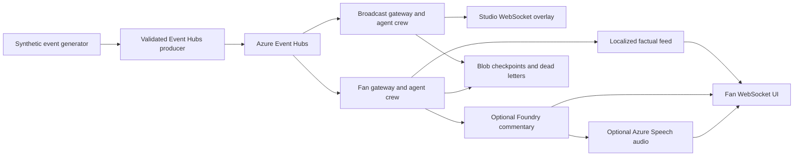

# PitchPulse AI

PitchPulse AI turns synthetic football match events into tactical signals for a broadcast studio and a match-scoped fan feed. The studio shows the event timeline, pitch position, pass difficulty, nearby defensive pressure, passing accuracy, and optional AI commentary. Fans can choose English, Spanish, French, German, or Arabic, select a commentary style, and opt into speech. Localized factual updates work without cloud AI credentials.

This repository contains a working local demo and Azure deployment definitions. It does **not** include a licensed live match feed. Foundry text generation requires a configured model deployment. Azure staging is only live after the deployment workflow succeeds.

## Architecture



The [architecture notes](docs/ARCHITECTURE.md) describe the data contract, algorithms, Azure resources, and current limits. The [pitch overview](docs/PITCH.md) covers the audience, features, and tech stack.

## Run the local demo

Use Python 3.11 or 3.12 from the repository root:

```powershell
python -m venv .venv
.venv\Scripts\python -m pip install -r requirements-gateway.txt
.venv\Scripts\python -m scripts.demo_local
```

Open [the studio](http://127.0.0.1:8000/studio?match_id=demo-match) and [the fan feed](http://127.0.0.1:8000/fan?match_id=demo-match). The demo streams generated match events through the same validation, analysis, and WebSocket code used by the Azure gateway. Stop it with Ctrl+C. No Azure account is needed for the factual demo.

## Test and benchmark

```powershell
.venv\Scripts\python -m pip install -r requirements-dev.txt
.venv\Scripts\python -m unittest discover -s tests -v
.venv\Scripts\python -m scripts.benchmark_stream --events 200 --studio-clients 10 --fan-clients 50
```

The benchmark measures in-process event validation, agent analysis, and WebSocket sends to in-memory transports. It excludes Event Hubs, network travel, Foundry, and speech. [CI](.github/workflows/ingestion-ci.yml) also builds both container images and tests against the Event Hubs emulator. After Azure deployment, the [staging verifier](scripts/verify_staging.py) publishes real events and measures both deployed WebSockets.

## Azure staging setup

The [deployment workflow](.github/workflows/deploy-infrastructure.yml) uses GitHub Actions OIDC. Follow the [Azure setup guide](docs/AZURE_SETUP.md) to create a resource group and trusted Entra application, then add these repository settings under **Settings → Secrets and variables → Actions**:

| GitHub setting | Name | Value |
| --- | --- | --- |
| Secret | `AZURE_CLIENT_ID` | Entra application ID |
| Secret | `AZURE_TENANT_ID` | Entra directory ID |
| Secret | `AZURE_SUBSCRIPTION_ID` | Azure subscription ID |
| Variable | `AZURE_RESOURCE_GROUP` | Existing target resource group |
| Variable | `AZURE_LOCATION` | That resource group's Azure region |
| Variable | `EVENT_HUB_NAMESPACE_NAME` | Globally unique Event Hubs namespace name |
| Variable | `EVENT_HUB_NAME` | Match event hub name |

Optionally set `FOUNDRY_PROJECT_ENDPOINT` and `FOUNDRY_MODEL` together as repository variables, and grant the gateway identity access to the Foundry model. Without them, studio analysis and multilingual factual fan updates still run; generated prose is unavailable. Speech uses the Azure Speech resource provisioned by the infrastructure deployment.

Push to `main` or run **Deploy Azure services** from GitHub Actions. The workflow builds the gateway image in Azure Container Registry, deploys broadcast and fan Container Apps, prints their URLs, and runs the staging verifier. The [operations guide](src/gateway/OPERATIONS.md) lists runtime settings.

## Current limits

- Inputs are synthetic and match statistics are in memory; a restart does not restore cumulative statistics.
- The broadcast view has no analyst sign-in. Use it only with synthetic or otherwise approved data.
- Live Foundry and Speech output depends on cloud credentials and service availability. The factual event path stays separate from those slower tasks.
- The sub-second target applies to factual event delivery. It is verified locally by CI and must pass the Azure staging benchmark before any live latency claim.

## Demo and competition video

The [two-minute pitch video](media/pitchpulse-pitch.mp4) shows the local synthetic demo and explains the product. It is not footage from a live licensed match or a claim of a completed Azure deployment.

[Studio capture](media/studio-demo.png) · [Spanish fan capture](media/fan-demo.png) · [Video narration](media/VIDEO_SCRIPT.md)
